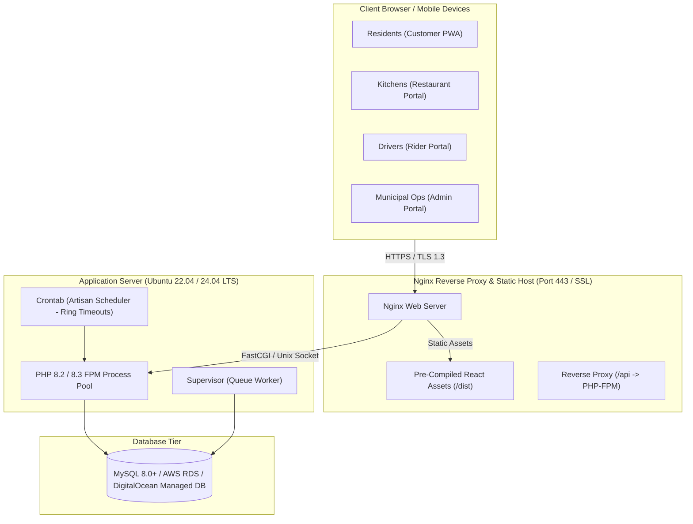

# DashBite — Production Deployment & Operations Guide (Task W8.02)

**Document Owner:** Cyrel (System Architect) & Jelvie (Lead Full-Stack Engineer)  
**Target Architecture:** Multi-Tier Web Application (Nginx + PHP 8.2+ FPM + MySQL 8.0+ + Vite SPA)  
**Release Version:** v1.1  
**Date:** November 12, 2026  
**Status:** **Approved for Production Handover**

---

## 1. Production Architecture Overview

The DashBite system consists of two primary runtime tiers and a persistent database tier:



---

## 2. Infrastructure & Prerequisites

### 2.1 Recommended Server Specifications
- **Operating System:** Ubuntu 22.04 LTS or 24.04 LTS x86_64
- **Compute (Small Town, <50k residents):** 2 vCPU, 4 GB RAM (e.g. AWS `t3.medium`, DigitalOcean Droplet 4GB, or Linode 4GB)
- **Compute (Medium Town, 50k-150k residents):** 4 vCPU, 8 GB RAM
- **Storage:** 40 GB+ NVMe SSD
- **Database Engine:** **MySQL 8.0+** (Recommended) or MariaDB 10.5+ with `utf8mb4_unicode_ci` default collation.

### 2.2 System Packages Required
```bash
sudo apt update && sudo apt upgrade -y
sudo apt install -y nginx git curl unzip supervisor certbot python3-certbot-nginx
sudo apt install -y php8.2 php8.2-fpm php8.2-mysql php8.2-curl php8.2-mbstring \
                    php8.2-xml php8.2-zip php8.2-bcmath php8.2-intl
```

---

## 3. Database Setup (Production)

### 3.1 Provisioning MySQL Database
Create a dedicated database and secure user on your MySQL instance:
```sql
CREATE DATABASE dashbite_production CHARACTER SET utf8mb4 COLLATE utf8mb4_unicode_ci;
CREATE USER 'dashbite_user'@'%' IDENTIFIED BY 'StrongRandomPassword!2026#';
GRANT ALL PRIVILEGES ON dashbite_production.* TO 'dashbite_user'@'%';
FLUSH PRIVILEGES;
```

---

## 4. Backend Deployment (`dashbite-backend`)

### 4.1 Cloning and Directory Permissions
```bash
cd /var/www
git clone https://github.com/dashbite/dashbite-backend.git backend
cd /var/www/backend
git checkout feat/integrate-and-qa

sudo chown -R www-data:www-data /var/www/backend/storage /var/www/backend/bootstrap/cache
sudo chmod -R 775 /var/www/backend/storage /var/www/backend/bootstrap/cache
```

### 4.2 Installing PHP Dependencies
```bash
composer install --no-dev --optimize-autoloader
```

### 4.3 Environment File Configuration (`.env`)
Create `/var/www/backend/.env` with production-hardened values:
```ini
APP_NAME=DashBite
APP_ENV=production
APP_KEY=base64:GENERATE_WITH_ARTISAN_KEY_GENERATE
APP_DEBUG=false
APP_URL=https://dashbite.yourtown.gov.ph

LOG_CHANNEL=daily
LOG_LEVEL=error

DB_CONNECTION=mysql
DB_HOST=127.0.0.1
DB_PORT=3306
DB_DATABASE=dashbite_production
DB_USERNAME=dashbite_user
DB_PASSWORD=StrongRandomPassword!2026#

SESSION_DRIVER=database
SESSION_LIFETIME=120
SESSION_ENCRYPT=true

QUEUE_CONNECTION=database
CACHE_STORE=database

SANCTUM_STATEFUL_DOMAINS=dashbite.yourtown.gov.ph
```

Generate the encryption key:
```bash
php artisan key:generate
```

### 4.4 Running Migrations & Production Seeder
```bash
php artisan migrate --force
php artisan db:seed --force
```

### 4.5 Production Optimization & Cache Compilation
Compile configurations, routes, and views for sub-millisecond execution:
```bash
php artisan config:cache
php artisan route:cache
php artisan view:cache
```

---

## 5. Background Workers & Dispatch Automation

### 5.1 Crontab for Dispatch Ring Timeouts
The dispatch scheduler expands rings and handles ring timeouts every minute:
```bash
sudo crontab -u www-data -e
```
Add the following single entry:
```cron
* * * * * cd /var/www/backend && php artisan schedule:run >> /dev/null 2>&1
```

### 5.2 Supervisor Configuration for Queue Workers
Create `/etc/supervisor/conf.d/dashbite-worker.conf`:
```ini
[program:dashbite-worker]
process_name=%(program_name)s_%(process_num)02d
command=php /var/www/backend/artisan queue:work database --sleep=3 --tries=3 --max-time=3600
autostart=true
autorestart=true
stopasgroup=true
killasgroup=true
user=www-data
numprocs=2
redirect_stderr=true
stdout_logfile=/var/www/backend/storage/logs/worker.log
stopwaitsecs=3600
```
Start the worker:
```bash
sudo supervisorctl reread
sudo supervisorctl update
sudo supervisorctl start all
```

---

## 6. Frontend Deployment (`dashbite-frontend`)

### 6.1 Compiling Assets
On your build machine or CI/CD runner:
```bash
cd dashbite-frontend
npm install
npm run build
```
Transfer the generated `dist/` directory to `/var/www/frontend`:
```bash
sudo mkdir -p /var/www/frontend
sudo cp -r dist/* /var/www/frontend/
sudo chown -R www-data:www-data /var/www/frontend
```

---

## 7. Nginx Server Configuration

Create `/etc/nginx/sites-available/dashbite.conf`:
```nginx
server {
    listen 80;
    server_name dashbite.yourtown.gov.ph;
    return 301 https://$host$request_uri;
}

server {
    listen 443 ssl http2;
    server_name dashbite.yourtown.gov.ph;

    ssl_certificate /etc/letsencrypt/live/dashbite.yourtown.gov.ph/fullchain.pem;
    ssl_certificate_key /etc/letsencrypt/live/dashbite.yourtown.gov.ph/privkey.pem;
    ssl_protocols TLSv1.2 TLSv1.3;
    ssl_ciphers HIGH:!aNULL:!MD5;

    # Frontend Single Page App Root
    root /var/www/frontend;
    index index.html;

    # Security Headers
    add_header X-Frame-Options "SAMEORIGIN";
    add_header X-XSS-Protection "1; mode=block";
    add_header X-Content-Type-Options "nosniff";
    add_header Referrer-Policy "strict-origin-when-cross-origin";

    # Gzip Compression
    gzip on;
    gzip_types text/plain text/css application/json application/javascript text/xml application/xml application/xml+rss text/javascript;

    # 1. Backend API Routing
    location ^~ /api {
        alias /var/www/backend/public;
        try_files $uri $uri/ @api_fallback;

        location ~ \.php$ {
            include fastcgi_params;
            fastcgi_param SCRIPT_FILENAME /var/www/backend/public/index.php;
            fastcgi_param SCRIPT_NAME /index.php;
            fastcgi_pass unix:/var/run/php/php8.2-fpm.sock;
            fastcgi_index index.php;
            fastcgi_buffer_size 16k;
            fastcgi_buffers 4 16k;
        }
    }

    location @api_fallback {
        rewrite ^/api/(.*)$ /index.php?$query_string last;
    }

    # 2. Frontend SPA Routing (Fallback to index.html)
    location / {
        try_files $uri $uri/ /index.html;
    }

    # Static Assets Cache
    location ~* \.(js|css|png|jpg|jpeg|gif|ico|svg|woff|woff2|ttf|eot)$ {
        expires 30d;
        add_header Cache-Control "public, no-transform";
    }

    location ~ /\.ht {
        deny all;
    }
}
```

Enable site and restart Nginx:
```bash
sudo ln -s /etc/nginx/sites-available/dashbite.conf /etc/nginx/sites-enabled/
sudo nginx -t
sudo systemctl reload nginx
```

Obtain SSL certificate via Certbot:
```bash
sudo certbot --nginx -d dashbite.yourtown.gov.ph
```

---

## 8. Post-Deployment Verification Checklist

1. [ ] **Public Health & API Connectivity:** Verify `curl -I https://dashbite.yourtown.gov.ph/api/catalog/restaurants` returns HTTP 200.
2. [ ] **SSL & HTTPS Enforcement:** Verify accessing `http://dashbite.yourtown.gov.ph` redirects with HTTP 301 to `https://`.
3. [ ] **Debug Mode Disabled:** Verify `.env` has `APP_DEBUG=false` so stack traces are never exposed to clients.
4. [ ] **Zero Secrets in Git:** Verify git repository does not track `.env` or production credentials.
5. [ ] **Heartbeat & Dispatch Verification:** Confirm a test order triggers `SEARCHING_RIDER` and offers broadcast to online riders in the 1 km ring.
6. [ ] **Zero Platform Fee Preserved:** Confirm in `payment_records` table that `platform_fee` is strictly `0.00` on test deliveries.
